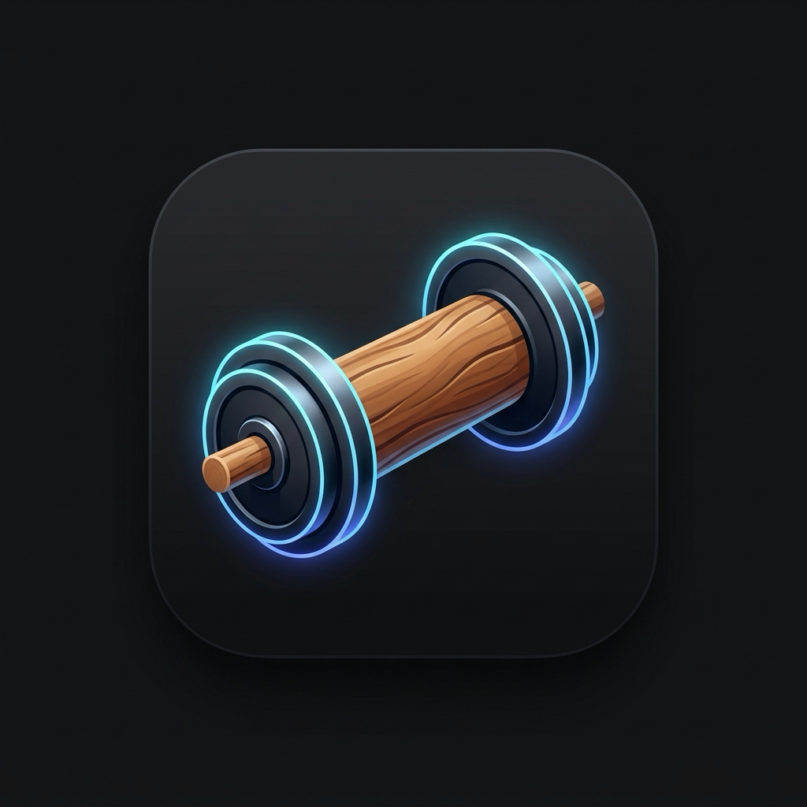

<p align="center">
  
</p>

<h1 align="center">Timburr</h1>

<p align="center">
  <b>Carry your training log everywhere.</b><br>
  An offline-first workout log for Android. Lift, run, rest, repeat. It syncs when it can.
</p>

<p align="center">
  <a href="https://github.com/danielrispler/timburr/releases/latest"></a>
  
  
  
</p>

> Timburr is the Pokémon that carries a wooden log everywhere. This app carries yours.

---

## Why Timburr

- **No signal? No problem.** Every set saves to the phone first. Sync to your own Supabase project happens in the background.
- **Built for the gym floor.** Big −/+ steppers, tap-to-type, one tap to mark a set done.
- **Your data, your server.** One user, one private database. Export a full backup any time.

## Features

### 🏋️ Strength
- Live workouts with steppers (2.5 kg / 1 rep / 5 s), done toggles and supersets.
- **"Last time"** on every exercise, so you know what to beat.
- **PR badges** the moment you beat a previous best.
- Rest timer bar that pops up after each set, without blocking the screen.
- Sticky notes per exercise, plus one-off session notes.
- Log a workout after the fact with **"I did it"**.

### 📋 Saved workouts
- Build routines with planned sets ("3 sets • 10 reps").
- Start one live, or log it as done in one tap.
- Finished differently than planned? Timburr offers to update the routine.

### 🏃 Cardio and sports
- Run, walk, treadmill, bike, swim, padel, tennis, soccer and basketball.
- Distance, duration, heart rate, incline and RPE. Pace is computed for you.
- Weekly time and session stats for sports.
- Read heart rate and calories from a Google Health screenshot.

### 📚 Exercise library
- A big bundled library with search and muscle and equipment filters.
- Animated demos, downloaded on first view.
- Custom exercises for anything missing.

### 📈 Progress
- Estimated 1RM, volume and PR history per exercise, with charts.
- History of every workout and cardio session, filterable by type.

### ☁️ Sync and safety
- Header status: `synced`, `N pending`, `offline` or `error`.
- Last write wins, and unsynced edits are never overwritten.
- Backup and restore to a file, with a reminder every 14 days.
- Import old logs from JSON, in the app or from the command line.

## Get it

1. Download the APK from the [latest release](https://github.com/danielrispler/timburr/releases/latest).
2. Open it on your phone and allow the install.
3. Sign in with your Supabase account (see setup below).

Timburr is a personal app. It needs your own free Supabase project to sync.

---

<details>
<summary><b>🛠️ Setup and development</b></summary>

### Supabase setup

1. Create a project at [supabase.com](https://supabase.com). The free plan is enough. Pick a region near you.
2. Open **SQL Editor** and run each file in [`supabase/migrations/`](supabase/migrations/) in order: paste it and click **Run**.
3. Create your user: **Authentication > Users > Add user > Create new user**. Enter your email and password, and tick **Auto Confirm User**.
4. Disable sign-ups: **Authentication > Sign In / Providers**, turn off **Allow new users to sign up**, then **Save**.
5. Copy your keys from **Project Settings > API Keys**: the Project URL and the **publishable** key (`sb_publishable_...`, or the legacy `anon` key).
6. Create `.env.json` (git-ignored) and fill it in:

   ```sh
   cp .env.example.json .env.json
   ```

Never put the secret / `service_role` key in `.env.json`, the app or this repo. The app only needs the publishable key: RLS limits every row to its owner.

A free project pauses after about 7 days of low activity. The app keeps working offline. Restore the project from the dashboard and sync resumes.

### Development

Needs the Flutter SDK and Android Studio (for the Android SDK). Flutter finds Android Studio's bundled Java by itself.

```sh
flutter run --dart-define-from-file=.env.json        # app on a device or emulator
flutter build apk --dart-define-from-file=.env.json  # APK in build/app/outputs/flutter-apk/
flutter test                                         # unit tests
adb install -r build/app/outputs/flutter-apk/app-release.apk  # update the phone, keeps local data
(cd supabase && npm install && npm test)             # migration tests in PGlite, no Docker
```

### Import from the command line

`tool/timburr-import` writes a v1 import file (format: `importFormat` in [`lib/data/importer.dart`](lib/data/importer.dart)) straight into Supabase. It uses the service_role key, which bypasses RLS, so it stamps and filters every row with your user id. It pulls your data into memory, runs the app's importer (same validation and name matching) and pushes the result. The phone picks it up on its next sync. An AI assistant can write the JSON and run the command.

Add `SUPABASE_SERVICE_ROLE_KEY` (Project Settings > API Keys, the secret key) and `TIMBURR_USER_ID` (Authentication > Users, your UID) to `.env` (git-ignored), next to `VITE_SUPABASE_URL`. That key never goes in `.env.json`, the app or the repo. Sync the phone first: last write wins.

```sh
tool/timburr-import workouts.json --dry-run        # validate, list new custom exercises, write nothing
tool/timburr-import workouts.json --save-routines  # import; an unknown "routine" name becomes a saved workout
```

### Signed release builds

Every build must use the same keystore, or Android refuses to install updates over the old app.

1. Create the keystore once, outside the repo:

   ```sh
   export JAVA_HOME="/Applications/Android Studio.app/Contents/jbr/Contents/Home"
   "$JAVA_HOME/bin/keytool" -genkeypair -v -keystore ~/timburr-release.jks \
     -alias timburr -keyalg RSA -keysize 4096 -validity 36500
   ```

2. Back up `~/timburr-release.jks` and its passwords in a password manager (for example, as an attachment). If you lose them, you cannot ship updates to the installed app.
3. Create `android/key.properties` (git-ignored):

   ```properties
   storeFile=/Users/you/timburr-release.jks
   storePassword=...
   keyAlias=timburr
   keyPassword=...
   ```

4. Build: `flutter build apk --release --dart-define-from-file=.env.json`. Without `key.properties`, release builds fall back to the debug key.

The env vars `TIMBURR_KEYSTORE_PATH`, `TIMBURR_KEYSTORE_PASSWORD`, `TIMBURR_KEY_ALIAS` and `TIMBURR_KEY_PASSWORD` override `key.properties`.

#### GitHub release

Pushing a `v*` tag (for example `git tag v0.2.0 && git push origin v0.2.0`) runs `.github/workflows/release.yml`. It builds the signed APK with `versionCode` = the workflow run number and attaches it to a GitHub Release. First add these repository secrets (**Settings > Secrets and variables > Actions**):

- `KEYSTORE_BASE64`: the output of `base64 -i ~/timburr-release.jks`
- `KEYSTORE_PASSWORD`, `KEY_ALIAS`, `KEY_PASSWORD`
- `SUPABASE_URL`, `SUPABASE_PUBLISHABLE_KEY` (the publishable key only, never `service_role`)

### Exercise library

The bundled library is [exercises-dataset](https://github.com/hasaneyldrm/exercises-dataset) (data and text MIT), pinned to one commit and trimmed by `node scripts/build-exercises.mjs`, which writes `assets/exercises.json`. Its animations are © Gym visual (https://gymvisual.com/) and are not covered by the MIT licence: the app downloads them on demand and shows the credit. Exercises logged under the earlier free-exercise-db ids map to the new ids through `legacyIds`.

</details>

## Credits

Exercise data from [exercises-dataset](https://github.com/hasaneyldrm/exercises-dataset) (MIT). Animations © [Gym visual](https://gymvisual.com/). Spec: [#3](https://github.com/danielrispler/timburr/issues/3). Design: [docs/design.md](docs/design.md).
